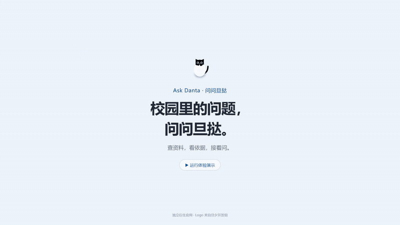

# Ask Danta · 问问旦挞

面向复旦大学校园场景的多源检索问答应用。

Ask Danta 结合公开网页与经授权访问的旦挞茶楼（树洞）资料，为校园办事、课程学习和校园生活等问题提供带来源引用的回答。系统通过 Agent 工具调用完成检索与上下文读取，并支持答案核对、多轮追问和本地会话管理。

本项目为独立开发的衍生应用，采用单用户本地运行方式。

完整功能与安装包说明见 [1.0.0 中英文发布概览](docs/releases/v1.0.0.md)。

## 项目演示

[](docs/media/ask-danta-demo.mp4)

[观看完整视频](docs/media/ask-danta-demo.mp4) · 约 35 秒 · 1080p · 界面操作录屏

演示涵盖数据源选择、实时执行记录、引用查证、树洞配图、多轮追问及历史会话管理。视频录制自实际界面，使用合成资料；示例内容及响应时长不代表真实校园信息或服务性能。素材与复现方法见[演示说明](docs/media/README.md)。

## 主要功能

| 功能 | 说明 |
| --- | --- |
| 多源检索 | 支持公开网页搜索与正文读取，以及经授权的树洞搜索与帖子上下文读取。 |
| 数据源控制 | 提供“自动选择”“仅网页”“网页 + 树洞”三种模式；仅网页模式隔离先前对话中的树洞证据。 |
| 来源引用 | 回答通过 `W`、`C` 编号分别关联网页与树洞资料，可展开查看摘要、链接、日期和内容截断状态。 |
| 执行过程展示 | 实时显示检索、读取及答案核对等步骤，以及工具状态和耗时；支持停止当前请求。 |
| 多轮对话 | 结合当前会话上下文处理追问，并在本机保存消息、引用及执行记录。 |
| 消息操作 | 支持复制问题与回答；最后一轮失败后可在原会话重新发送，替换失败轮次，不新增侧边栏对话；编辑历史问题时从该位置创建新对话，保留原对话。 |
| 资料与会话管理 | 支持 Markdown 排版、树洞图床配图展示，以及会话新建、切换、重命名和删除。 |

## 技术架构

前端使用 **React、TypeScript 和 Vite**，通过 HTTP 接口管理会话，并使用 SSE 接收执行事件。后端使用 **FastAPI、HTTPX 和 Pydantic**，负责模型调用、检索工具、认证与数据校验；会话记录使用 **SQLite** 持久化。

一次问答的主要处理流程为：

```text
用户问题与会话上下文
        ↓
Agent 规划与工具选择
        ↓
公开网页检索 / 树洞检索 → 按需读取原文或帖子上下文
        ↓
答案生成与引用核对
        ↓
返回回答、来源引用与执行记录 → 保存至本机会话
```

Agent 在单轮时间、工具调用次数和树洞分页预算内执行检索。校园调研策略由仓库内的 [ask-danta-research Skill](skills/ask-danta-research/SKILL.md) 提供。执行状态实时推送，回答正文在核对完成后统一展示。

答案核对与修订使用非思考模式，主回答和检索决策仍遵守设置页的思考选项。核对保留完整证据、引用与用户要求校验，修订后按预算重新核对；相同原文不再重复附在核对记录中。小样本速度对照见[核对速度验证](docs/review-speed-verification.md)。

核对阶段遇到输出截断、空回复、响应格式错误或上游生成中断时，剩余预算允许则自动重试一次，保持原有输出上限、调用次数与总时限。核对仍失败时显示具体原因并支持重新发送，不发布未核对的候选答案或堆放搜索摘要。已取得的资料保留在本机会话中。

非思考核对触发补查后，模型请求适配器补齐思考模式所需的工具调用协议字段，再继续生成答案；此兼容处理不关闭思考或核对，也不将内部思考内容保存到聊天记录。

## 部署与配置

### 桌面应用

项目支持 Electron 桌面打包，安装包包含前端与独立 Python 后端，使用者无需安装 Python、Node.js 或 uv。源码开发仍可运行 `python scripts/dev.py`，或在根目录运行 `npm run dev`，保留 Vite 热更新。

首次构建在项目根目录执行：

```sh
python scripts/setup.py
npm ci
uv sync --frozen --group desktop
npm run desktop:dist
```

安装包输出到 `release/`。`npm run desktop:pack` 只生成解包应用；`npm run desktop:dev` 构建前端后启动桌面窗口（修改前端后需重新运行，不提供桌面热更新）。详细构建、数据位置和 GitHub Release 操作见[桌面构建与发布](docs/desktop.md)。

桌面应用使用项目内的 Danta 猫咪 logo，移除 Electron 默认的 File、Edit 等菜单栏，保留系统窗口标题栏与窗口控制按钮。

### 环境要求

- Python 3.11 或更高版本。
- [uv](https://docs.astral.sh/uv/getting-started/installation/)，用于管理 Python 依赖。
- Node.js 22.12 或更高版本及 npm。
- 可用的模型服务密钥；启用真实网页搜索时另需 Tavily API Key。

### 1. 安装依赖

在项目根目录执行：

```sh
python scripts/setup.py
```

安装脚本只安装项目依赖，无需创建 `.env`。

### 2. 启动应用

```sh
python scripts/dev.py
```

- 应用入口：[http://127.0.0.1:5173](http://127.0.0.1:5173)
- API 文档：[http://127.0.0.1:8000/docs](http://127.0.0.1:8000/docs)

前后端默认仅监听本机回环地址。使用 `Ctrl+C` 停止服务。

### 3. 在设置中配置服务

打开侧栏底部的“设置”，在“模型”中填写接口地址、模型名称和 API Key，保存后即可对话，无需修改 `.env` 或重启服务。在“网页搜索”中选择 Tavily 并填写其 API Key，可启用真实网页搜索；“高级”中可调整答案核对、超时、工具调用与内容长度等参数。

API Key 只显示是否已配置，留空保留原值；“清除”操作在保存后生效。设置保存到本机 `.private/settings.json`，重启服务后自动恢复。模型、搜索和回答参数只读取这份设置文件，不读取 `.env` 或同名环境变量。进行中的回答需要完成或停止后才能保存设置。

未保存过的设置使用程序默认值，API Key 默认为空。常用设置如下，完整说明见[接口与配置参考](docs/api-reference.md)。

默认最大输出为 16384 Token，单次模型超时为 120 秒，单轮总时限为 300 秒；思考强度默认为低。已有设置会保留，不因程序默认值变更而自动覆盖。

| 配置项 | 默认值 | 用途 |
| --- | --- | --- |
| 接口地址 | `https://api.deepseek.com` | 模型服务接口地址。 |
| 模型名称 | `deepseek-flash` | 对话与工具调用使用的模型名称。 |
| 模型 API Key | 空 | 模型服务认证密钥。 |
| 搜索服务 | 合成样例 | 可选择 Tavily 启用真实网页搜索。 |
| Tavily API Key | 空 | Tavily 服务认证密钥。 |
| 答案核对 | 开启 | 启用答案语义与证据核对。 |

`mock` 仅替代网页搜索服务，不替代模型服务。使用默认搜索配置时，样例结果会在界面中明确标记，不能作为实际问题的证据。

启动端口与文件路径可通过系统环境变量 `BACKEND_PORT`、`FRONTEND_PORT`、`CAMPUS_AUTH_FILE`、`SESSION_DB_FILE` 指定，修改后重启。默认端口为 `8000`／`5173`，默认路径见下方数据管理表。

从旧版本升级时，可执行 `uv run --frozen python scripts/migrate_settings.py` 一次性导入旧 `.env`。设置页已保存的值会保留，其余用户设置导入本机设置文件；旧文件随后归档到 `.private/legacy-config/`，不再参与启动配置。自定义端口和文件路径需改用系统环境变量。

### 4. 配置树洞访问（可选）

在取得社区要求的访问授权后，可通过“设置 → 账号 → 登录树洞”登录，也可使用项目提供的交互式登录脚本：

```sh
uv run --frozen python scripts/campus_login.py
```

树洞凭据由本项目独立管理。未配置树洞账号不影响仅网页模式；首次启用树洞检索时，界面会提示相关资料将发送至模型服务。

## 数据管理与使用边界

| 数据 | 默认存储位置或处理方式 |
| --- | --- |
| 会话记录 | `.private/history/chat.sqlite3`，保存聊天消息、必要引用片段与执行记录。 |
| 树洞凭据 | `.private/campus-tokens.json`，与会话记录分开保存。 |
| 服务配置 | `.private/settings.json` 保存用户设置和密钥，重启后恢复，仅当前本机用户可访问。 |
| 模型输入 | 问题、相关会话上下文及回答所需的检索材料发送至已配置的模型服务。 |
| 网页搜索 | 启用 Tavily 时，检索词发送至 Tavily 服务。 |
| 树洞配图 | 展开来源后，由浏览器按需请求 `image.fduhole.com` 图床，不发送当前页面的 Referer。 |

`.env`、`.private/` 及其包含的凭据和历史数据不纳入版本控制。当前实现面向单用户本地使用，未提供多用户账号体系或跨设备同步。

公开网页与树洞帖子具有不同的证据属性：正式政策和办事要求应以学校发布的信息为准，树洞内容仅代表发帖者的个人经验。系统保留资料截断、来源不可用及未完成核对等提示；引用关联与自动核对不等同于事实正确性保证。

## 项目结构

```text
backend/app/              后端接口、Agent、模型与数据源适配器
frontend/src/             前端页面、交互组件与样式
frontend/e2e/             浏览器端回归测试
tests/                    后端及适配器测试
skills/ask-danta-research/   校园调研策略
scripts/                  安装、启动、验证与演示录制脚本
docs/                     接口文档与演示素材
plan.md                   开发计划与阶段验收记录
```

## 开发与验证

```sh
# 后端测试
uv run --frozen pytest -q

# TypeScript 检查与前端构建
npm --prefix frontend run build

# 浏览器回归测试
npm --prefix frontend run test:e2e
```

自动化测试使用合成响应，不依赖真实模型或校园账号。浏览器测试默认使用本机 Chrome，并在 `8006`、`5176` 端口启动独立测试服务。

实际服务联调可使用 `scripts/check_search.py`、`scripts/check_campus.py` 和 `scripts/check_research_chat.py`。这些脚本需要相应服务配置，可能访问真实资料或消耗模型及搜索额度；运行条件见脚本说明和[开发计划](plan.md)。

## 项目来源与致谢

旦挞校园助手由 **旦夕开发组（DanXi-Dev）** 开发。本项目使用的 Logo 来自旦挞官网发布的校园助手图标。

- [旦夕开发组](https://github.com/DanXi-Dev)
- [旦挞校园助手](https://danxi.fduhole.com/project/app)
- [Logo 原图](https://danxi.fduhole.com/assets/app.webp)

旦挞茶楼为旦挞团队开发和运营的校内匿名社区，本项目界面中简称“树洞”。使用相关接口应遵循[旦挞社区服务使用协议](https://danxi.fduhole.com/doc/community-user-agreement)，并取得第三方访问所需的授权。
